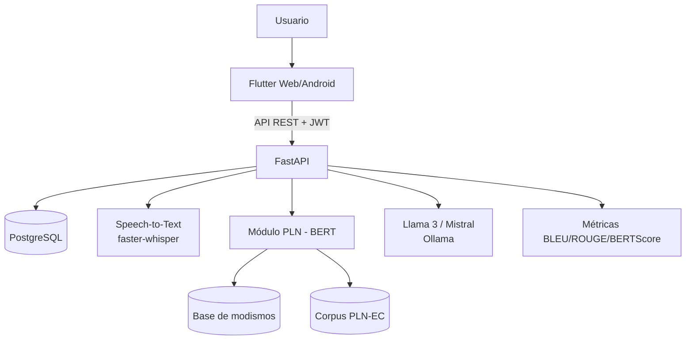
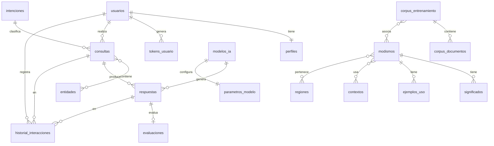

# Arquitectura del sistema

## Vista de componentes

## Flujo de una consulta (`POST /queries`)
1. Validación (≤ 500 caracteres) y, si es audio, transcripción con Whisper.
2. **PLN:** intención (BETO afinado o reglas) → entidades (BERT-NER o reglas) → detección de modismos (índice en memoria: normalización sin tildes, plurales, género, errores tipográficos leves).
3. **Recuperación:** pasajes del corpus por búsqueda de texto completo en español (`to_tsvector('spanish', …)`).
4. **Prompt:** instrucciones del sistema + intención + entidades + glosario de modismos (significado, región, ejemplo) + pasajes + últimos turnos del usuario.
5. **Generación** con el modelo activo y los parámetros del administrador (temperatura, top-p, tokens).
6. **Persistencia:** consulta, entidades, respuesta, historial (una transacción).
7. **Evaluación en segundo plano:** BLEU/ROUGE/BERTScore de la respuesta contra el conocimiento recuperado (glosario + corpus) si `AUTO_EVAL=true`.

## Modelo entidad-relación

## Seguridad
- Contraseñas con bcrypt; JWT de acceso (60 min) y refresco (7 días); control de acceso por rol en cada ruta `/admin/*`.
- Verificación de correo y recuperación con tokens de un solo uso almacenados como hash SHA-256.
- Nunca se envían datos a APIs externas: modelos, voz y métricas se ejecutan localmente.
- Producción: HTTPS (proxy inverso), `CORS_ORIGINS` restringido, `JWT_SECRET` y claves fuera del repositorio, respaldo de la BD.

## Escalabilidad
Backend sin estado (réplicas tras un balanceador); Ollama/Whisper son los cuellos de botella y pueden moverse a otro host (`OLLAMA_URL`). Reentrenamiento: `GET /admin/knowledge/export.jsonl` exporta el conocimiento de modismos para afinar el modelo sin detener el servicio.
